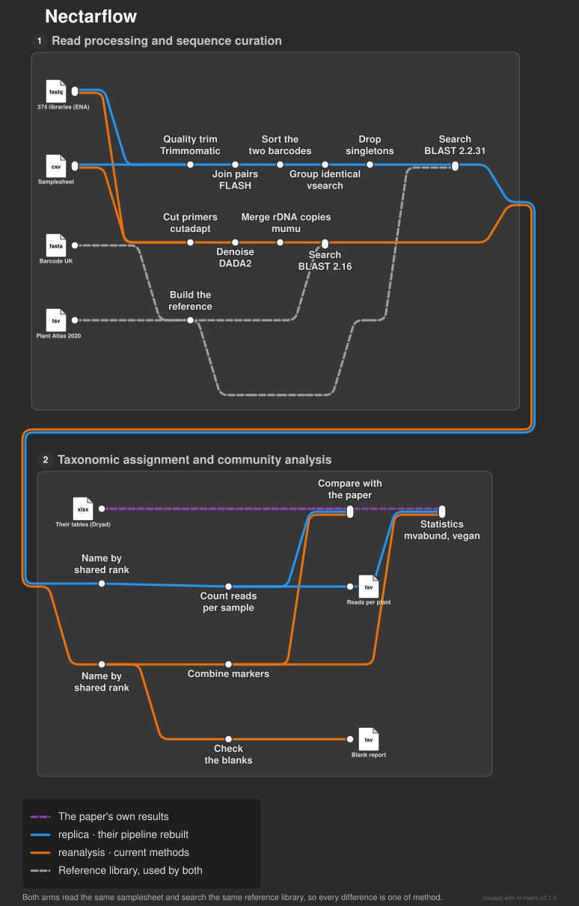
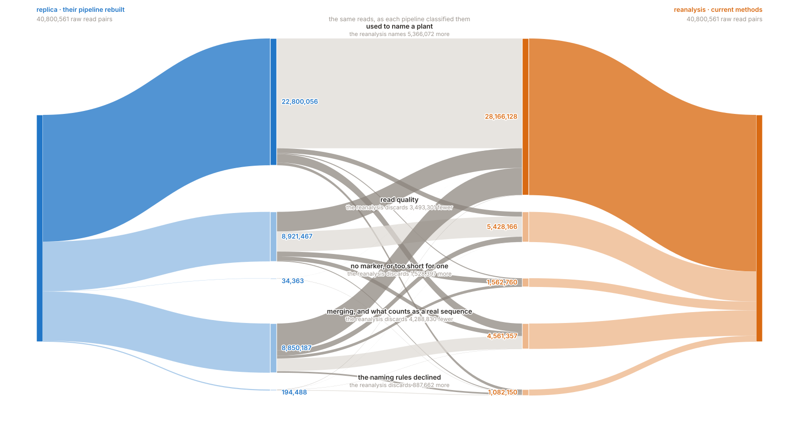
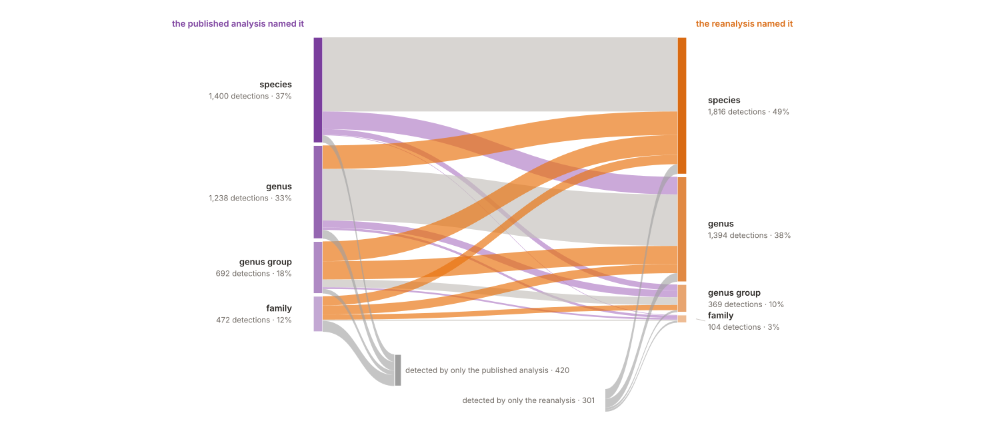
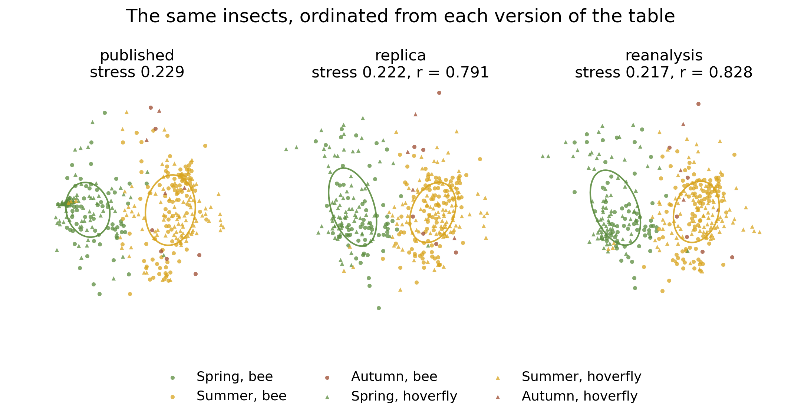
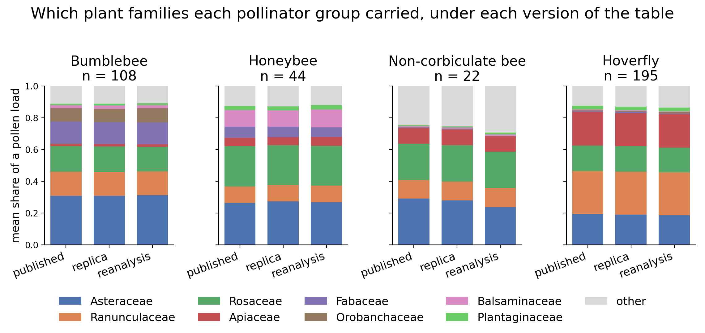

# Nectarflow

An attempt to reimplement one published DNA metabarcoding study in Nextflow and run it twice: once
as the authors published it, and once with the methods the field uses now. The first asks how closely
the published numbers come back from the public data; the second asks what changes if the same reads
are processed differently.

This is outside work, written from the paper, the authors' own pipeline script and the public
deposits, with no involvement from them. It is not a test of the study and not a validation of it.
Where it agrees with the paper, that is one reimplementation agreeing with another; where it
differs, the published work is the one to cite.

The study is [Lowe, Jones, Brennan, Creer & de Vere 2022](https://doi.org/10.1111/1365-2664.14144)
(*Journal of Applied Ecology* 59: 1484-1495), pollen carried by bees and hoverflies across eight
sampling areas of one 230 ha site in Wales, the National Botanic Garden of Wales and Waun Las
National Nature Reserve, over two years, identified from DNA. 374 sequencing libraries, two barcode
markers, 369 insects, 40,800,561 raw read pairs.
[Reads](https://www.ebi.ac.uk/ena/browser/view/PRJNA763761) ·
[published tables](https://doi.org/10.5061/dryad.rjdfn2z9s) ·
[original pipeline](https://github.com/colford/nbgw-plant-illumina-pipeline)

**What came out.** On this run the two pipelines disagree about the names of the plants and agree
about the ecology. 28% of the raw read pairs are used by one pipeline and discarded by the other,
and the published contrasts come back much the same, to within a percentage point of read share
&mdash; hoverflies on hogweed and buttercups, bees on thistles and knapweeds, honeybees on
*Impatiens glandulifera*. Where the pipelines part is the taxon *names*, and the reason is a rule
rather than a resolution limit.

## The two pipelines

[](docs/figures/pipelines.svg)

One line per arm, from the reads to the statistics, with the shared inputs dashed.

**replica** is a reimplementation of the authors' pipeline as published, following their script
wherever it and the paper disagree. **reanalysis** processes the same reads with current methods. Both read the same
samplesheet, search the same reference library (Barcode UK and GenBank over the Plant Atlas, pinned
by accession, reaching 257 of the 286 published labels), combine their two markers with the same
process and go through the same statistics script, so the differences below are differences of
method rather than of inputs. What could not be followed, and what each forced choice cost against the published tables, is
itemised in [`docs/replica.md`](docs/replica.md).

| stage | replica | reanalysis |
|---|---|---|
| primer recognition | their regex on a primer fragment, `HEADCROP:3`, leaving 3 of 6 random bases | cutadapt, both primers and the full 6N spacer removed |
| merging, quality | FLASH 1.2.11, then a length floor | DADA2 filtering, then merge |
| clustering, denoising | vsearch 2.3.2 at 100% identity | DADA2 exact variants, error model per sequencing run |
| artefact removal | study-wide singletons dropped (16.9% of rbcL, 29.6% of ITS2 reads) | chimeras (12.2%, 3.0%), then mumu co-occurrence curation |
| identification | blastn top 20, their consensus rule | blastn, lowest common ancestor over the tie band, with identity floors per marker |
| blanks | sequenced with the samples; the controls are in Appendix S2 | all four reported in the output tables, no subtraction applied |

## The read budget

Every raw read pair under each pipeline, classified by what a step was *for* rather than by which
tool ran it. The middle is a read-by-read cross-tabulation of the 40,800,561 pairs, so the shading
says only whether the two agree about a read.

[](docs/figures/read_fates.svg)

| fate | replica | reanalysis | |
|---|---:|---:|---|
| used to name a plant | 22,800,056 | 28,166,128 | **+5,366,072** |
| read quality | 8,921,467 | 5,428,166 | &minus;3,493,301 |
| no marker, or too short for one | 34,363 | 1,562,760 | +1,528,397 |
| merging, and what counts as a real sequence | 8,850,187 | 4,561,357 | &minus;4,288,830 |
| the naming rules declined | 194,488 | 1,082,150 | +887,662 |

The difference runs both ways. The largest single flow, 4,849,138 reads, is at the step deciding
which sequences are real: the replica drops 7,149,542 reads in clusters of one, where DADA2
attributes such a read to a variant. The replica's bin is larger than sequencing error alone would
make it, because `HEADCROP:3` leaves three of the six random spacer bases and splits one sequence
into as many as 64 variants.

## How the plants got named

[](docs/figures/naming_crossing.svg)

Counted as detections, one per insect and plant family, so both sides are on the same scale: of the
3,382 plants both found, 1,785 stop at the same rank, 1,131 are finer under the reanalysis and 466
coarser, with 420 detections made only by the published analysis and 301 only by the reanalysis,
out of 4,103.

Where the reanalysis is coarser the cause is the rule that turns BLAST hits into a name, not what
the sequences can reach. Two families account for 90 of its 131 disagreements about the dominant
plant, and in both the published label names several close genera where the lowest common ancestor
climbs to the family they share. The replica reads the same way: on the same reads and the same
library it emits 270 slash labels of 784, labels of exactly the published shape. Both rules are
defensible and they are not the same rule; [`docs/results.md`](docs/results.md) works it through.

| | replica | reanalysis |
|---|---:|---:|
| rbcL read mass at genus or finer | 95.8% | 72.4% |
| rbcL read mass at a bare family name | 4.2% | 26.1% |
| ITS2 read mass at species | 93.8% | 61.3% |

So by read mass the reanalysis is the coarsest of the three, not the finest. What it buys is not resolution but
chimera removal, full spacer and primer handling, a per-run error model, co-occurrence curation
that leaves 29 of its 422 taxa carrying ten reads or fewer against 211 of the replica's 784, the
blanks reported, and a rank tied to the identity that supports it.

## What the insects carried

[](docs/figures/composition_by_month.png)

The paper's title result. The pollen turns over through the season and the two groups diverge
inside it: in July and August the bees are on Asteraceae where the hoverflies are on Apiaceae, and
in September the bees move to Himalayan balsam. Bars are the mean share of an insect's load, so a
deeply sequenced insect does not outweigh a shallow one.

[](docs/figures/preference.png)

Their own floral surveys record the most abundant flowering plants per transect and season, which
makes a selectivity index possible: both groups use some families far above their share of the
flowering area and avoid others. The wind-pollinated families are the control the index is read
against: nettle is 10.7% of the summer flowering area and 0.0% of the bee pollen, grasses 4.6% and
0.2%, oak 3.7% of the spring area and nothing at all.

[](docs/figures/ordination.png)

The same 367 insects ordinated from each of the three tables: *published* is the paper's own table, *replica* the authors' pipeline rebuilt, *reanalysis* the same reads through current methods. Spring and summer separate in all
three and the arrangements are the same arrangement; two insects carry a single taxon each and sit
at distance 1 from almost everything, so no ordination can place them and they are dropped. No run
converged and every stress is above 0.2, so this is read for its arrangement and not its distances.

## What changes when the method changes

[](docs/figures/composition_by_table.png)

The paper's group contrasts, drawn once per version of the table (*published* is the paper's own table, *replica* the authors' pipeline rebuilt, *reanalysis* the same reads through current methods). They are the same picture three
times, which is the most useful thing to come out of this: removing the chimeras, recovering reads
the original discarded and assigning coarser names leaves it where it was.

| mean share of a load | the paper's table | replica | reanalysis |
|---|---|---|---|
| Apiaceae, bees against hoverflies | 0.034 / 0.209 | 0.034 / 0.208 | 0.036 / 0.211 |
| Asteraceae, bees against hoverflies | 0.291 / 0.192 | 0.295 / 0.191 | 0.287 / 0.184 |
| Ranunculaceae, bees against hoverflies | 0.134 / 0.268 | 0.134 / 0.269 | 0.133 / 0.267 |
| Balsaminaceae, honeybees | 0.101 | 0.102 | 0.110 |

The model is the one the authors selected by AIC, season and year and pollinator order, run by
[`bin/ecology.R`](bin/ecology.R) over all three tables. Their own test, a manyglm, is run on each
and reported in [`docs/results.md`](docs/results.md), where on the published table it returns that
table's own deviances to within 6% to 13%. Below is the PERMANOVA R2, the share of the total
between-insect dissimilarity a term accounts for; it is not one of the paper's tests.

| | their table | replica | reanalysis |
|---|---|---|---|
| season, PERMANOVA R2 | 0.141 | 0.086 | 0.094 |
| bees against hoverflies, PERMANOVA R2 | 0.033 | 0.021 | 0.023 |
| ordination, Procrustes fit to the published arrangement (367 insects) | &mdash; | 0.791 | 0.828 |

Read these for the ordering rather than the level: a table with more labels spreads the same pollen
over more rows, so R2 falls even where the ecology is identical. In all three, season dominates, the
bee-and-hoverfly term is well clear of zero, and the two arms agree with each other more closely
than either does with the published arrangement, at a Procrustes fit of 0.933. year is in the model
because the authors selected it there and is not read on its own (see Limitations).

As a control on all of the above, the replica recovers the published per-insect compositions at a
median Bray-Curtis similarity of 0.986 and 0.992 for the two markers. That closeness is what makes the comparison
worth reading, and is not itself a finding.

| | replica | reanalysis |
|---|---:|---:|
| rbcL, the authors' taxon labels | **0.986** | 0.897 |
| ITS2, the authors' taxon labels | **0.992** | 0.954 |
| rbcL, rolled up to family | **0.997** | 0.980 |
| ITS2, rolled up to family | **0.994** | 0.964 |
| rbcL, insects whose dominant plant agrees | **322** of 369 | 238 |
| ITS2, insects whose dominant plant agrees | **352** of 369 | 331 |

## Scope

Of the paper's four questions this answers two: how foraging differs between the pollinator groups,
and how it changes over season. The functional-category split and the native-against-non-native
comparison are not run; `docs/replica.md` says why.

## Limitations

- **This is one reimplementation, not an independent test.** Both arms inherit the study's design,
  its primers and its reads, so agreement between them says that the published numbers can be
  recovered by someone following the same script against a public library, and says nothing about
  whether the original choices were the right ones. The reanalysis arm is an alternative, not a
  correction.
- **The reference library is a public stand-in.** The authors' own was not deposited; the species
  lists behind it are two books and the garden's own catalogue of what it has planted, which
  carries no licence. This one is built from Barcode UK and GenBank over the Plant Atlas 2020
  alone, and reaches 257 of the 286 published names. The 29 it misses are ornamentals of the
  planted beds. Taxon-level agreement cannot exceed what it covers.
- **The two sampling years coincide with the sequencing runs**, 2018 being run 1 and 2019 runs 2
  and 3, so a year term here describes year and run together.
- **Read share is not pollen quantity.** Every number compares proportions of sequences, which
  carry the biases of PCR and of marker copy number.
- **The reads carry no sample of known composition**, so the two naming rules are compared with
  each other and with the published labels rather than scored for accuracy.

## Running it

```bash
# 1. the samplesheet (or pass --accession PRJNA763761 and let the pipeline build it)
bin/ena_samplesheet.py PRJNA763761 -o samplesheet.csv

# 2. the replica, into its own directory
nextflow run replica.nf -profile conda -resume \
    --input samplesheet.csv --published assets/published/Supporting_Data.xlsx \
    --outdir results/faithful

# 3. the reanalysis, pointed at the replica so the two can be compared
nextflow run reanalysis.nf -profile conda -resume \
    --input samplesheet.csv --published assets/published/Supporting_Data.xlsx \
    --replica_results results/faithful \
    --conda_ecology /abs/path/to/ecology_env \
    --outdir results/reanalysis

nextflow run reanalysis.nf -stub-run   # checks the wiring, installs nothing
```

The two must publish into different `--outdir`s. Needs [Nextflow](https://www.nextflow.io/) and
conda; `-profile dev` runs 20 samples instead of 374. The one exception to self-installation is the
R package `mvabund`, which conda does not carry, so the statistics take `--conda_ecology` pointing
at a prepared environment; [`assets/ecology_env.yml`](assets/ecology_env.yml) rebuilds the exact one
these numbers came from.

More: [`docs/replica.md`](docs/replica.md) each original step and its replacement ·
[`docs/reanalysis.md`](docs/reanalysis.md) each departure and what it did to the numbers ·
[`docs/results.md`](docs/results.md) every number with its caveats ·
[`docs/steps.md`](docs/steps.md) both pipelines parameter by parameter ·
[`docs/figures.md`](docs/figures.md) how each figure is made

## Provenance and licence

The study, the reads and the published tables belong to their authors. This is a replication, not a
correction. Where a pipeline here disagrees with the paper it is a difference of method, and the
original is the work to cite. The paper is open access under CC BY, so it is quoted directly.

> Lowe A, Jones L, Brennan G, Creer S, de Vere N (2022) Seasonal progression and differences in major
> floral resource use by bees and hoverflies in a diverse horticultural and agricultural landscape
> revealed by DNA metabarcoding. *Journal of Applied Ecology* 59: 1484-1495.
> [doi:10.1111/1365-2664.14144](https://doi.org/10.1111/1365-2664.14144)

| | Source | Terms |
|---|---|---|
| Reads | [ENA PRJNA763761](https://www.ebi.ac.uk/ena/browser/view/PRJNA763761) | not redistributed here; the pipeline downloads them |
| Published tables | [Dryad 10.5061/dryad.rjdfn2z9s](https://doi.org/10.5061/dryad.rjdfn2z9s) | CC0, the deposit README ships beside the file in `assets/published/` |
| Original pipeline | [colford/nbgw-plant-illumina-pipeline](https://github.com/colford/nbgw-plant-illumina-pipeline), GPL-3 | no code or file copied; `docs/replica.md` maps each step to its replacement |
| Trimmomatic adapter lists | Trimmomatic, GPL-3 | not copied here; `TRIM` takes the stock list by name from the installed package |
| Reference sequences | GenBank and Barcode UK, pinned by accession in `assets/reference_manifest.tsv` | NCBI places no restriction on GenBank records; each keeps its own terms |
| Species lists | BSBI Plant Atlas 2020 (Stroh et al. 2024, [doi:10.5281/zenodo.11097371](https://doi.org/10.5281/zenodo.11097371)) | CC BY 4.0, attributed in the file header |
| | National Botanic Garden of Wales Garden Explorer | **not used.** The authors' library also covered the garden's living collection; that catalogue carries no licence statement, so nothing here is built from it |

The works this reproduction leans on are listed in
[`docs/references.md`](docs/references.md). The code, documentation and figures are MIT, in
`LICENSE`. That covers this work alone and does not extend to the reads, the published tables, the
sequence records or the species lists above.

Built in September and October 2026 as an independent reproduction, by one person, from public data.
