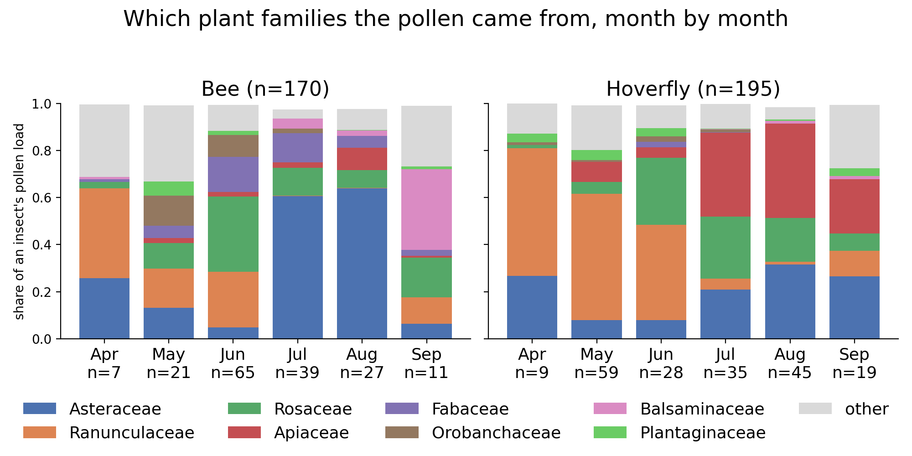
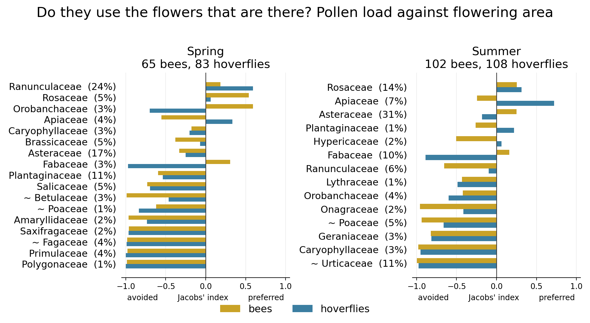

# Results

Both pipelines, all 374 libraries (369 insects, one of them sequenced twice, and 4 blanks). The replica is a reimplementation of the authors' own
method; the reanalysis puts the same reads through current ones. The run reported here started 12 October 2026
and finished 13 October at 11:29, both arms from nothing and both exit 0, on all samples of
PRJNA763761 against the pinned reference library and the Dryad `*_consensus_ID_read_counts` sheets. The ecology was run by
one script on three tables, so the pipelines are compared on their conclusions and not only on their
read counts.

## Part 1: the replica against the published tables

369 insects matched; the pipelines have 374 samples, 373 of them with rbcL, including the controls,
which are not in the published sheets.

**Which way round the numbers run.** Every comparison below reports Bray-Curtis **similarity**,
`sum(min(p_i, q_i))` over the two samples' proportions, so **1 is the same composition and 0 shares
nothing**: 0.988 means near-identical, not near-opposite. This is one minus the Bray-Curtis
dissimilarity that `vegan::vegdist` returns, and the dissimilarity is what the PERMANOVA and the NMDS
in `bin/ecology.R` use, because adonis2 and metaMDS take a distance. The two orientations are both in
this repository on purpose; the column names now carry the word.

### Per-insect agreement, published consensus labels

| comparison | marker | median BC similarity | mean | samples >= 0.9 | samples < 0.5 | dominant taxon identical |
|---|---|---|---|---|---|---|
| replica vs published | rbcL | **0.986** | 0.888 | 287 | 34 | 322 of 369 |
| replica vs published | ITS2 | **0.992** | 0.948 | 332 | 11 | 352 of 369 |
| reanalysis vs published | rbcL | 0.897 | 0.657 | 184 | 121 | 238 of 369 |
| reanalysis vs published | ITS2 | 0.954 | 0.885 | 258 | 21 | 331 of 369 |
| replica vs the reanalysis | rbcL | 0.945 | &mdash; | 219 | 95 | 266 of 373 |
| replica vs the reanalysis | ITS2 | 0.970 | &mdash; | 286 | 15 | 341 of 371 |

The replica reproduces the published per-insect compositions. Median read counts per insect differ by
1.61% (rbcL) and 2.12% (ITS2) from theirs.

### Rolled up to family

| comparison | marker | median BC similarity | samples >= 0.9 | samples < 0.5 | dominant family identical |
|---|---|---|---|---|---|
| replica vs published | rbcL | **0.997** | 358 | 3 | 366 of 369 |
| replica vs published | ITS2 | **0.994** | 344 | 5 | 356 of 369 |
| replica vs the reanalysis | rbcL | 0.980 | 348 | 5 | 360 of 373 |
| replica vs the reanalysis | ITS2 | 0.973 | 300 | 12 | 344 of 371 |
| reanalysis vs published | rbcL | 0.980 | 341 | 7 | 354 of 369 |
| reanalysis vs published | ITS2 | 0.964 | 278 | 18 | 331 of 369 |

The reanalysis's disagreement with the published tables is almost entirely above the family. At family rank
it rises from 0.897 to 0.980 (rbcL) and from 0.954 to 0.964 (ITS2), and the samples below 0.5 fall
from 121 to 7. Whatever the reanalysis is doing differently, it is naming, not finding, different plants.

### By sample group (median Bray-Curtis similarity, published labels, rbcL)

| group | n | replica vs the reanalysis | replica vs published | reanalysis vs published |
|---|---|---|---|---|
| GBC | 60 | 0.922 | 0.993 | 0.906 |
| GBG | 94 | 0.948 | 0.995 | 0.928 |
| GTF | 76 | 0.952 | 0.961 | 0.905 |
| HBC | 45 | 0.949 | 0.975 | 0.836 |
| HBG | 48 | 0.940 | 0.987 | 0.776 |
| SCR | 17 | 0.978 | 0.992 | 0.972 |
| SW | 17 | 0.953 | 0.988 | 0.920 |
| WBC | 13 | 0.963 | 0.986 | 0.945 |

The replica is at or above 0.96 in every group. The reanalysis is weakest in the hay-meadow groups HBG and HBC,
which is where the Asteraceae and Apiaceae labels discussed in Part 3 concentrate.

### What can be claimed

That the published per-insect plant compositions were reproduced from the public reads with the
group's own method, at median Bray-Curtis similarity 0.986 and 0.992, with the dominant plant agreeing for 322
and 352 of 369 insects. That is the claim this repository supports, and it is the only one that
should appear in a CV or a letter.

What cannot be claimed is that the published taxon *names* were reproduced. They were not, and
Part 3 explains why not. The honest summary of my position is that my resolution rests more on
sequence evidence and less on ecological context than theirs does, because that is what was
available to me. I had the public reads and a public reference library. I did not have the flora of
the transects in my head, the plant list of the garden, or two field seasons of knowing which
composites were in flower in July. From where I stood I leveraged what was defensible, which is the
sequence and the library, and I let the labels be as coarse as that evidence makes them.

## Part 2: the reanalysis arm

### Phase 2, denoising

| | rbcL | ITS2 |
|---|---|---|
| pairs after primer split | 17,725,130 | 21,512,671 |
| after quality filtering | 14,530,609 | 19,279,026 |
| denoised | 14,505,960 | 19,242,880 |
| merged | 14,325,994 | 17,187,285 |
| non-chimeric | 12,574,058 | 16,674,220 |
| ASVs before curation | 3,085 | 2,764 |
| ASVs after mumu | 908 | 1,146 |

Of 40,800,561 raw pairs, 1,562,760 (3.8%) matched neither primer pair. Chimeras cost 12.2% of
merged rbcL reads and 3.0% of ITS2.

### Phase 3, how coarse the answers are (reanalysis)

| rank | rbcL ASVs | rbcL reads | ITS2 ASVs | ITS2 reads |
|---|---|---|---|---|
| species | 115 | 2,400,016 | 168 | 9,719,397 |
| genus | 196 | 3,861,283 | 640 | 5,619,012 |
| genus_group | 68 | 2,661,749 | 27 | 409,490 |
| family | 100 | 3,210,721 | 64 | 80,339 |
| order | 227 | 185,618 | 16 | 18,503 |
| order_spanning | 18 | 139,156 | 23 | 271,660 |
| unassigned | 169 | 89,830 | 157 | 538,236 |
| ASV too short | 15 | 25,685 | 51 | 17,583 |

ITS2 resolves better than rbcL at this step: 58% of ITS2 reads reach a species against 19% of rbcL.
17.5% of rbcL reads and 34.4% of ITS2 reads have no exact match in the library, which is the
library's limit and not the denoiser's.

### Phase 4, the blanks

The blanks are reported in this pipeline's own output tables, and no subtraction is applied.

| control | marker | reads | ASVs | % of marker reads | top taxon |
|---|---|---|---|---|---|
| Extr_ctrl_1 | ITS2 | 3,484 | 3 | 0.021 | Veronica spp. (53%) |
| Extr_ctrl_2 | ITS2 | 936 | 2 | 0.006 | Cosmos spp. (90%) |
| H2O_1 | ITS2 | 0 | 0 | 0.000 | none |
| H2O_2 | ITS2 | 0 | 0 | 0.000 | none |
| Extr_ctrl_1 | rbcL | 8 | 1 | 0.000 | Ranunculus spp. |
| Extr_ctrl_2 | rbcL | 3,897 | 1 | 0.031 | Chasmanthe/Crocosmia spp. |
| H2O_2 | rbcL | 525 | 1 | 0.004 | Chasmanthe/Crocosmia spp. |
| H2O_1 | rbcL | not in the table | — | — | — |

All four blanks are listed against both markers, eight cells, because an absence and a measured
zero are different facts. The seven cells with a number are measurements. `H2O_1` has no rbcL row
at all: it is absent from the table rather than empty in it, and the cause is not established, so
it is not written as a zero.

One ASV is flagged `control_dominant`: ITS2 `Veronica spp.`, 1,836 reads in Extr_ctrl_1 against 506
across two real samples, so 78% of its total reads are in a blank. It should not be read as pollen.
`Chasmanthe/Crocosmia spp.` appears in both an extraction blank and a water blank at 100% of their
reads but carries 69,374 reads in 81 real samples, so it reads as contamination of the blanks
rather than of the samples. Everything else is minor or bleed-like.

## The pollen itself

Buttercups carry the spring, and they carry it hardest for the hoverflies: Ranunculaceae is 53% of the
mean hoverfly load in April and 55% in May, against 38% and 16% for the bees. In June the bees move
onto brambles and roses first, Rosaceae 32% against Ranunculaceae 24%, while the hoverflies are still
on buttercups at 40%. In July the two groups part company: bees are 62% Asteraceae while hoverflies
put 36% of their load on Apiaceae, hogweed and its relatives. August holds that split, 64% against
40%. In September the bees go to Himalayan balsam, 30%. Both of the paper's claims are visible in one
picture. Every percentage here is the mean share of an insect's load, which is what the bars are, not
the pooled reads of the month.

The metadata separates four groups rather than two, and `composition_by_table.png` draws them that
way. The finer split is by
season rather than by month, because monthly cells fall to one or two insects: solitary bees are 22
insects in total. Bumblebees and honeybees turn out to diverge in summer, the honeybees taking twice
the Rosaceae (31% against 16%) and nearly four times the balsam (11% against 3%) while the bumblebees
take twice the Fabaceae (18% against 8%). The paper reports its four groups separately as well, in its
Figure 3b, Figure 4 and Table 2; this is a different cut of the same contrast.

Their own floral surveys record the ten most abundant flowering plants per transect and season, as a
proportion of ground area. Comparing that with what ended up in the pollen gives Jacobs' index: zero
means a family was used exactly as often as it was available. The wind-pollinated families are the
control, and they behave: nettle is 10.7% of the summer flowering area and 0.0% of the bee pollen,
grasses 4.6% and 0.2%, oak 3.7% of the spring area and nothing at all. Against that baseline the real
preferences stand out, summer hoverflies on Apiaceae at +0.72 while bees sit at -0.24, and bees on
Fabaceae at +0.16 in summer and +0.31 in spring where hoverflies score -0.89 and -0.97. This
comparison, a used-against-available selectivity index, is not one the paper reports; the paper uses
the transect floral composition in its Results and gives the most abundant plants per transect and
season in Appendix S1 (p.1486).

What the availability data is, in their words: "the most abundant plants across both years per
transect area per season" (Methods, page 1486), given as a proportion of the transect area in flower,
up to ten plants per transect and season, pointing at Appendix S1. Insects were caught on eight
210 m x 2 m transects, walked monthly from March to October in 2018 and 2019 between 11:00 and 15:00
above 10 degrees, and frozen at -20 C.

Three caveats, in order of weight. **How the proportion in flower was estimated is not described**: the
main text points to Appendix S1 for the most abundant plants per transect area per season (p.1486),
and Appendix S1 could not be obtained here. **The list is truncated** at the ten most abundant plants per
transect and season, so a family absent from it is not necessarily absent from the site, which makes
under-use the safer half of any claim. **Availability is pooled**: insects are compared against the
flowering area of all eight transects in their season, not the transect they were caught on, though
the data would allow that match.

The figures come from `bin/make_figures.py`. The ordination is drawn from `bin/ordination.R` rather
than from phase 6, because phase 6 ordinates every sample and two of them cannot be placed:
`GTF2_818_5`, whose whole load is `Heuchera/Tiarella spp.` in 223,087 reads, and `HBC1_318_1`. Each
sits at Bray-Curtis distance 1 from almost every other insect, so NMDS pushes it to the edge of the
configuration and leaves the other 367 in a knot. `bin/ordination.R` drops any sample at distance 1
from 95% of the others, raises the try count to 400 and reports what it dropped.

## Their Table 2, rebuilt

Table 2 of the paper lists the plant taxa making up over 10% of the sequence reads for each pollinator
group in each season. It is the most direct comparison available, because it is a list of names rather
than a similarity score. Rebuilt from the reanalysis arm, pooling reads within each group and season:

| group | season | n | published Table 2 | reanalysis, over 10% |
|---|---|---|---|---|
| Bumblebee | Spring | 42 | *Ranunculus/Ficaria* spp., *Rubus* spp. | *Ranunculus* spp. 25%, *R. acris* 10% |
| | Summer | 62 | *Cirsium/Centaurea/Hypochaeris* spp., *Rubus* spp. | *Centaurea/Echinops* spp. 35%, Asteraceae 21% |
| | Autumn | 4 | *Aster* spp., *Clematis* spp., *Rubus* spp. | *Rubus* spp. 29%, *Rosa/Rubus* spp. 15%, *Clematis* spp. 15%, *Symphyotrichum* spp. 12% |
| Honeybee | Spring | 11 | *Ranunculus/Ficaria* spp., *Taraxacum officinale* | *Ranunculus* spp. 19%, *Ficaria* spp. 12%, *Veronica* spp. 12%, *Taraxacum* spp. 11%, *Pulmonaria* spp. 11% |
| | Summer | 31 | *Cirsium/Centaurea/Hypochaeris* spp., *Impatiens glandulifera*, *Rubus* spp. | *Impatiens glandulifera* 22%, *Rosa/Rubus* spp. 16%, Asteraceae 14%, *Centaurea/Echinops* spp. 12% |
| | Autumn | 2 | *Actaea* spp., *Heuchera* spp., *Impatiens glandulifera* | *Impatiens glandulifera* 45%, *Heuchera/Tellima* spp. 19%, Ranunculaceae 12% |
| Solitary bee | Spring | 12 | *Geum* spp., *Ranunculus/Ficaria* spp., *Taraxacum officinale* | *Taraxacum* spp. 20%, *Geum* spp. 15% |
| | Summer | 9 | *Bidens/Coreopsis* spp., *Heuchera* spp., *Rudbeckia/Helenium* spp. | *Bidens/Coreopsis/Symphyotrichum* spp. 23%, *Astilbe/Heuchera/Tolmiea* spp. 17% |
| | Autumn | 1 | *Astrantia* spp. | *Astrantia* spp. 96% |
| Hoverfly | Spring | 83 | *Ranunculus/Ficaria* spp. | *Ranunculus* spp. 43% |
| | Summer | 108 | *Angelica/Heracleum* spp., *Cirsium/Centaurea/Hypochaeris* spp., *Rubus* spp. | *Heracleum sphondylium* 15%, *Angelica/Oenanthe* spp. 14% |
| | Autumn | 4 | *Angelica/Heracleum* spp., *Bidens/Coreopsis* spp., *Rudbeckia/Helenium* spp. | *Bidens/Coreopsis/Symphyotrichum* spp. 17%, *Rumex acetosa* 11% |

What differs between the columns is mostly how the reads are split between labels, and it cuts both
ways. We name *Ranunculus* and *Ficaria* separately where they wrote *Ranunculus/Ficaria* spp., and
*Heracleum sphondylium* where they wrote *Angelica/Heracleum* spp. Elsewhere we are coarser, saying
Asteraceae where they named a genus group, which is the identity floor refusing a name the match does
not support. And in one place the split is neither finer nor coarser, only different: bramble reads
land partly on `Rubus spp.` and partly on `Rosa/Rubus spp.`, two labels the authors would have
written as one.

Summing the labels that carry the genera inside each of their names recovers most of the apparent
disagreements. *Rubus* reaches 10.1% in the bumblebee spring cell, 11.5% in bumblebee summer and
11.1% in hoverfly summer; *Ranunculus* reaches 10.7% in the solitary-bee spring cell.

Two cells do not come back, and both are the ones that rest on almost no insects. In the honeybee
autumn cell, two insects, *Actaea* spp. is absent from our table altogether. In the hoverfly autumn
cell, four insects, their *Rudbeckia/Helenium* spp. reaches 0.2% here. The published *Aster* spp.
matches us only because *Aster* has been split since and the species concerned now sit in
*Symphyotrichum*, which is a taxonomy change rather than a measurement. Read the autumn row as an
illustration and not as a result.

## Part 3: do the published conclusions survive the method change

One script, three tables, one model: the two orders the authors selected by AIC. Seed 20260923,
R 4.3.3 with vegan 2.7.1 and mvabund 4.2.8, 999 permutations. All three runs use the same 369
insects and the same metadata file, so the only thing that differs between the columns is the
community table.

The manyglm is the authors' own test and its deviance is a sum over taxa, so it is read within a
column and not across. Run on the published table it returns 2,780 for season, 728 for year and 834
for the two orders, against the 2,632.8, 816.2 and 953.9 of the paper's own table, agreeing to
within 6% to 13%; that is the check that this implementation of their test behaves like theirs. The
comparison between tables is carried by the PERMANOVA R2, which is a share of the total
dissimilarity and so does not grow with the size of the table, and whose permutations are restricted
to within transect.

| | published table | replica | reanalysis |
|---|---|---|---|
| taxa in the table / in the model | 191 / 132 | 784 / 378 | 422 / 219 |
| season, PERMANOVA R2 | 0.1414 (p=0.001) | 0.0860 (p=0.001) | 0.0939 (p=0.001) |
| bees against hoverflies, PERMANOVA R2 | 0.0333 (p=0.001) | 0.0214 (p=0.001) | 0.0232 (p=0.001) |
| ordination, Procrustes fit to the published arrangement (367 insects) | &mdash; | 0.791 (p=0.001) | 0.828 (p=0.001) |
| distance matrices, correlation with the published one, at family | &mdash; | 0.994 | 0.983 |

year is in the model because the authors selected it there, and is not tabulated: the two sampling
years coincide with the sequencing runs, so the term describes year and run together.

**Season is the largest term in all three tables, and bees and hoverflies differ in all three.**
Those are the paper's claims and they survive the method change, on the model the authors selected:
the two-order term is well below season in every table and separable from zero in every table. Both measures of agreement put the reanalysis slightly closer to the published arrangement
than the replica is, and both pipelines closer to each other than either is to the published table;
it is nonetheless the coarsest of the three in taxonomic rank, as the table further down shows.

The ordination is read for its arrangement, which is what the Procrustes row measures. Two insects
carry a single taxon each and sit at Bray-Curtis distance 1 from almost every other insect, so they
are dropped before the three arrangements are compared and the comparison is over the 367 that
remain.

**The three taxon counts are not three measurements of the same thing, and should not be read as
one.** The published table uses a coarser, fixed vocabulary. Of the reanalysis's rbcL names, 96 are
identical to a published label, 103 are a species where theirs is a genus, 94 are a species or
genus where theirs is a family or tribe, 68 have no published counterpart at all, and 6 could map
to more than one and were sent to the most common; they collapse into 223 names, 155 of them
published labels. Reading 132 against 378 as a sensitivity comparison is wrong.

### The year term is not interpretable in any of the three tables

Year is perfectly confounded with sequencing run in this dataset.

| seq_run | 2018 | 2019 |
|---|---|---|
| run_1 | 155 | 0 |
| run_2 | 0 | 187 |
| run_3 | 0 | 27 |

There is no overlap, so the year term and the batch term are the same column and no permutation or
resample here can say which of the two produced a difference. This is a property of the design, not
of any pipeline, and it applies to the published column as much as to the pipelines. `ecology.R` now
detects it and prints it in every summary.

Both pipelines return year at p=0.001 where the published table returns p=0.088, and that difference is
**not** evidence of a finer biological signal. The cause is naming granularity, and it can be shown
with arithmetic. Take the replica's own table and rename its taxa onto the published labels, changing no
read and no sample, and the result returns to the published one on all three terms.

| | published | replica collapsed onto published labels |
|---|---|---|
| taxa | 191 | 245 |
| season R2 | 0.1396 | 0.1404 |
| year R2 | 0.00414 | 0.00427 |
| year p | 0.088 | 0.073 |
| insect group R2 | 0.0490 | 0.0468 |

Finer labels spread the community over more dimensions, which dilutes season (R2 0.14 to 0.084) and
exposes a year signal. Most of that exposed signal is reallocation between near-synonymous labels of
the same genus rather than turnover between plants: in the single largest case, `Centaurea spp.`
falls 3.48 percentage points while `Centaurea/Saussurea spp.` rises 4.35, so the two nearly cancel
once summed. 125 of 245 published labels split in the replica, and 34.9% of all within-label change
between the years disappears on summing. DADA2 fits an error model per sequencing run, so each
batch can earn slightly different labels on its own; because batch is year, that artefact and a real
year effect are indistinguishable here.

On this design the coarser vocabulary happens to be insensitive to something the finer labels
respond to, which is a property of the two vocabularies here and not a reason to prefer either.
Neither reading of the year term can be
separated from the sequencing run, so neither is a measurement of a year. Dropping the 211 low-read arm-1 taxa that carry 10 reads or fewer changes the PERMANOVA in no
digit to four decimal places, so the long low-read tail inflates the taxon count and explains
nothing.

### Did the reanalysis buy more resolution? No, and that is the point

Read mass by rank, with each pipeline's own labels and the rank read off the label shape.

| rank | replica rbcL | reanalysis rbcL | replica ITS2 | reanalysis ITS2 |
|---|---|---|---|---|
| species | 31.3% | 19.5% | 93.8% | 61.3% |
| genus_group | 34.2% | 21.6% | 0.0% | 2.6% |
| genus | 30.4% | 31.3% | 6.2% | 35.5% |
| family | 4.2% | 26.1% | 0.0% | 0.5% |
| higher | 0.0% | 1.5% | 0.0% | 0.1% |
| **genus or finer** | **95.8%** | **72.4%** | **100.0%** | **99.4%** |

The reanalysis is coarser on both markers. It pushes a quarter of rbcL read mass to a bare family name and
moves a third of ITS2 read mass from species to genus. By any direct measure of taxonomic
resolution it is the worse of the two pipelines, and that should be stated before anything else about
it.

The difference is in where each pipeline places the burden of proof. The published rule assigns a
sequence to a species when the top bit score belongs to one (p.1487), with no additional identity
floor, and the replica follows it, which puts 93.8% of ITS2 reads on a binomial. The reanalysis adds
identity floors taken from the published discrimination of the two markers and records each refusal.
The two settings answer the question differently; neither is scored here against a sample of known
composition. The reanalysis's floors are set from the published discrimination of the
two markers rather than from a calibration run here, and its notes record the refusals, for instance `demoted species->genus (best identity 99.13 < 100.0)`. One
substitution over 450 bp of rbcL separates genera in some clades, so a 99.13% match is not a
species. The reanalysis declines to make the call.

What the reanalysis actually buys is therefore not resolution. It is chimera removal, full
handling of the spacer and primers, an error model per sequencing run, co-occurrence curation that
leaves 29 of the reanalysis's 422 taxa carrying 10 reads or fewer where the replica's 784 carry 211, the blanks reported
in the output tables, and a rank tied to the identity
that supports it. The
trade is coarser labels for defensible ones, and it is a trade rather than a gain.

### Where the reanalysis loses resolution, and why

The reanalysis falls back to a bare family name where the published table names a genus group. Two families
account for 90 of its 129 dominant-taxon disagreements.

| published dominant | reanalysis dominant | samples |
|---|---|---|
| Cirsium/Centaurea/Hypochaeris spp. | Asteraceae | 58 |
| Angelica/Heracleum spp. | Apiaceae | 32 |

This is not the reference library, and it is not a threshold that was set wrong. The
`--max-genera 3` rule matches every published group label. What happens is that rbcL cannot
separate these genera at all, so more than three tie and the group label stops being a name:

| candidate set | genera tying | label |
|---|---|---|
| full library | 14 | Asteraceae |
| Barcode UK sequences only | 10 | Asteraceae |
| top 20 hits, as in their method | — | Asteraceae |

Ten *Barcode UK* genera sit at the same rbcL identity for the largest of these ASVs: Carduus,
Centaurea, Cirsium, Lophiolepis, Onopordum, Pilosella, Saussurea, Scorzonera, Silybum and Solidago.
Restricting the library to Barcode UK narrows 14 to 10, restricting hits to their top 20 moves
bare-family calls from 99 to 89, and a Great Britain flora filter removes only Berkheya and
Lophiolepis. None of them recovers the published label. `Hypochaeris` is in the library with 10
rbcL sequences and is not in the tie band of this ASV, so the published triple is a different grouping
from the one reachable here rather than a subset of it, and no parameter in this pipeline reproduces
it. The published Methods assign on the top bit scores (p.1487) and then assess whether the plants
named were present within the study site and the wider landscape; this reproduction has the first
step and not the second.

What reaches it is their rule for combining the two markers. The published label is not one
marker's answer to be matched hit for hit: their `consensus_identifications` sheet records it as
built from four marker-level calls, ITS2 *Centaurea* spp., ITS2 *Cirsium* spp., ITS2 *Hypochaeris
radicata* and rbcL *Cirsium* spp. The four rules behind that sheet are set out in the supporting
methods to the thesis chapter this paper became (Lowe 2022, pp.132-133), and one of them covers
this case: where one marker resolves a single genus and the other resolves several closely related
genera, the consensus names all of them. Their ITS2 resolved the three genera perfectly well. The
consensus step is what put them in one label.

The reanalysis takes the lowest common ancestor over the tie band, so in the same situation it
climbs to the family the genera share rather than listing a union. The replica, on the same reads
and the same library, emits 270 slash labels of its 784, among them `Carthamus/Centaurea/Saussurea spp.` and
`Carduus/Centaurea/Saussurea spp.`, so a multi-genus label of the published shape is well within
reach of these sequences. The difference is the combination rule and not the resolution.

The field record is consistent with their label without being its source. Of the 58 insects where
they say `Cirsium/Centaurea/Hypochaeris spp.` and the reanalysis says `Asteraceae`, 40 were netted
on *Centaurea nigra* and 12 on *Cirsium palustre*, 52 of 58 on two of the three genera named, and
*Centaurea nigra* is the most visited plant in the dataset. That is corroboration of the label, and
it is also why their botanical veracity check would have left it standing; it is not what produced
it.

The reproducibility point survives in a sharper form. What this reproduction needed in order to
reach the published labels was not the flora of the transects but the combination rule, which was
in the supporting information throughout. A method described in the main text as "a rule-based,
objective, and conservative decision process" (p.1487) is reproducible exactly to the extent that
the rules travel with the data, and here they travelled in a supporting appendix rather than in the
deposit. The deposited sheet records every label the rules produced, which is enough to check an
answer and not enough to regenerate one.

### What this changes in the write-up

- The claim is that the per-insect compositions were reproduced, not that the taxon names were.
- The year term is reported as uninterpretable in all three tables, with the batch table beside it.
- The pipelines are compared at family rank as well as at label rank, because that separates finding
  different plants from calling them different things.
- The taxon counts are reported with the name-translation breakdown next to them, never alone.

## What the reanalysis changes, in one line each

- the 6N spacer and both primers are removed, so one plant sequence is one sequence (replica leaves 3
  random bases plus the primers, splitting it into up to 64 variants);
- exact sequence variants with an error model per sequencing run, instead of 100% clustering plus a
  study-wide singleton filter;
- chimeras are looked for and removed, which costs 12.2% of merged rbcL reads and 3.0% of ITS2;
- a name is only as fine as the identity supports, with the floors set from the two markers' published
  discrimination, and a
  call that falls back to a bare family now records which genera tied and why;
- the blanks are reported in the output tables;
- the sequencing run reaches the ecology, so a study variable that is a function of the batch is
  reported as one instead of being tested as though it were not;
- the same analysis script is run on both pipelines and on the authors' own table, so the pipelines are
  compared on their conclusions and not only on their read counts.
